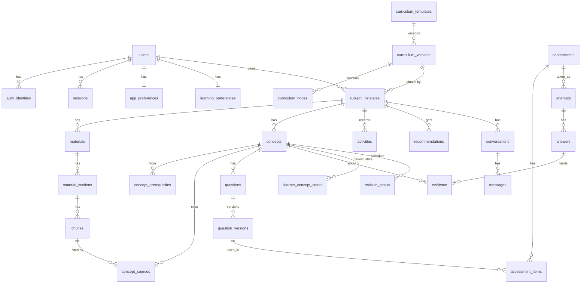

# RecallMap: Proposed Database Schema

**Status: PROPOSED. No migrations exist and none have been generated.** Drizzle ORM on PostgreSQL (Aiven) with pgvector. Last updated 2026-11-04.

## 1. Conventions

- UUID primary keys (`uuid`, generated in the application, UUIDv7 if available for index locality; confirm in B1). `timestamptz` everywhere. `created_at`/`updated_at` on mutable tables.
- Every learner-owned row carries `user_id` (denormalized where it avoids a join on the hot path) and every repository function requires it.
- Enums as Postgres enums or `text` + `CHECK` (decide in B1; `text` + `CHECK` is easier to migrate).
- Soft delete (`deleted_at`) only where history references the row (concepts, materials). User-requested deletion ends in a hard delete job (see section 6).
- Forward-only Drizzle migrations, expand/contract for breaking changes, each migration applied in CI against a throwaway database. `CREATE EXTENSION IF NOT EXISTS vector` is its own migration and needs a privileged role on Aiven (verify, DR-03).

## 2. Shared curriculum templates versus learner subject instances

**Rule: a learner can never mutate a template.** Templates are reusable and versioned; a learner's subject is a separate row that *references* a pinned template version and copies nothing back.

| Table | Key columns | Notes |
|---|---|---|
| `curriculum_templates` | id, slug (unique), title, education_system, board, level, status (draft/published/retired), created_by, created_at | `education_system` is data, not code: no country is hardcoded |
| `curriculum_versions` | id, template_id FK, version int, status, published_at, notes; unique (template_id, version) | **immutable once published**; changes make a new version |
| `curriculum_nodes` | id, version_id FK, parent_id self-FK, kind (subject/topic/objective), code, title, description, position | one tree per version; holds subjects and learning objectives |
| `subject_instances` (the learner "subject") | id, user_id FK, title, description, curriculum_version_id FK null, status (active/archived/deleting), created_at | null version = independent / self-directed learning |

A concept may reference `curriculum_node_id` (nullable) to align with an objective. A learner can move to a newer template version only through an explicit action that records what changed (no silent migration). `subject_curriculum_links` is **not** created: the pinned version plus `concepts.curriculum_node_id` covers the need (decision DR-09 confirms who authors templates).

## 3. Tables by module

### Identity

| Table | Columns (important) | Keys / indexes |
|---|---|---|
| `users` | id, email, email_verified, name, avatar_url, status, onboarded_at, deletion_requested_at, created_at | unique(email) |
| `auth_identities` | id, user_id FK, provider ('google'), provider_subject, created_at | unique(provider, provider_subject). Separate from `users` so account linking is explicit and future providers need no user-table change |
| `sessions` | id_hash (pk), user_id FK, created_at, last_seen_at, expires_at, revoked_at, user_agent | index(user_id), index(expires_at). Only the hash of the opaque token is stored |
| `oauth_states` | state_hash (pk), code_verifier_enc, redirect_to, expires_at | short-lived (minutes); deleted on use |
| `app_preferences` | user_id (pk FK), theme, map_layout ('hierarchical'/'dynamic'), accessibility jsonb, updated_at | application preferences |
| `learning_preferences` | user_id (pk FK), goals, education_level, curriculum_template_id null, explanation_style[], explanation_depth, question_difficulty, pace, revision_preferences jsonb, updated_at | learner-controlled; AI may *suggest* changes, never write here |

### Materials and documents

| Table | Columns | Keys / indexes |
|---|---|---|
| `materials` | id, user_id, subject_id FK, kind (file/pasted_text), original_filename, declared_mime, detected_mime, size_bytes, sha256, storage_key, status, failed_stage, error_code, page_count, extraction_method (text_layer/ocr/native), uploaded_at, processed_at, deleted_at | index(subject_id), index(user_id, status); unique(user_id, subject_id, sha256) to catch duplicate uploads |
| `processing_runs` | id, material_id FK, user_id, stage, status, attempt, pipeline_version, job_id, error_code, started_at, finished_at | index(material_id, stage); supports retries and audit |
| `material_sections` | id, material_id FK, ordinal, heading, page_start, page_end | unique(material_id, ordinal) |
| `chunks` | id, material_id FK, section_id FK, user_id, subject_id, ordinal, text, token_count, char_start, char_end, page, embedding vector(N), embedding_model, embedding_dim | `N` fixed per model (DR-06). Vector index see 5. char offsets and page make citations verifiable |

Status model (Proposed): `uploaded -> queued -> processing -> extracting -> embedding -> generating_concepts -> awaiting_review -> ready`, plus `failed` (with `failed_stage`, `error_code`). `ready` is set only when every required stage succeeded and the learner has confirmed the graph; a material that fails is never shown as processed.

### Knowledge graph (subject structure, learner independent)

| Table | Columns | Notes |
|---|---|---|
| `concepts` | id, user_id, subject_id FK, parent_id self-FK null, kind (topic/subtopic/concept), name, description, curriculum_node_id null, provenance (ai_generated/manual/edited), review_status (proposed/confirmed/rejected), generated_by_run_id null, created_at, updated_at, deleted_at | unique(subject_id, lower(name)) among non-deleted; index(subject_id, parent_id) |
| `concept_prerequisites` | concept_id FK, prerequisite_id FK, relation_type (prerequisite/related), provenance, review_status, confidence (AI only), rationale, created_at | pk (concept_id, prerequisite_id, relation_type); CHECK concept_id <> prerequisite_id; acyclicity for `prerequisite` edges validated in the service on every write |
| `concept_sources` | id, concept_id FK or edge ref, chunk_id FK, quote_start, quote_end, verified bool, verified_at | AI-claimed sources are checked against the stored chunk text; unverified claims are rejected, never shown as citations |
| `concept_revisions` | id, concept_id, user_id, actor (user/ai), change jsonb (before/after), at | edit history and provenance trail |

`relation_type = 'related'` is optional for the dynamic layout; MVP may ship prerequisite-only (DR-10).

### Assessment and evidence (learner specific)

| Table | Columns | Notes |
|---|---|---|
| `questions` | id, user_id, subject_id, concept_id FK, current_version_id | stable identity across edits |
| `question_versions` | id, question_id FK, version, type (multiple_choice/true_false/short_answer; extensible), prompt, options jsonb, answer_key jsonb, rubric jsonb, explanation, difficulty (easy/medium/hard), origin (ai/manual), prompt_version, model, status (draft/validated/retired), quality_flag, created_at | **immutable**; edits create a new version, so past attempts always point at exactly what the learner saw (this replaces separate attempt snapshots) |
| `assessments` | id, user_id, subject_id, kind (practice/check/follow_up/retention_check), title, created_at | assessment definition |
| `assessment_items` | assessment_id FK, question_version_id FK, position | pk (assessment_id, position) |
| `attempts` | id, user_id, assessment_id FK, activity_id FK null, started_at, completed_at, status | index(user_id, completed_at) |
| `answers` | id, attempt_id FK, question_version_id FK, response jsonb, grading_method (deterministic/ai_rubric), score numeric(3,2), is_correct, grading_confidence, grading_status (graded/pending), feedback_text, answered_at, graded_at | separates **evaluation** (score) from **feedback** (text); feedback can be regenerated without touching the score |
| `evidence` | id, user_id, concept_id FK, answer_id FK null, kind (observed_correct/observed_incorrect/observed_partial/inferred_misconception), is_inferred bool, weight_inputs jsonb (format, difficulty, repeat_n), summary, confidence (inferred only), created_at | observed evidence is derived from graded answers; **inferred rows are never used by the state engine** |
| `policy_versions` | version (pk), config jsonb, effective_from, notes | immutable snapshot of thresholds |
| `learner_concept_states` | (user_id, concept_id) pk, state (not_assessed/partial/demonstrated/suspected_gap), policy_version FK, derivation jsonb, last_evidence_at, computed_at | **derived cache** |
| `learner_state_transitions` | id, user_id, concept_id, from_state, to_state, policy_version, derivation jsonb, reason (new_evidence/policy_recompute), at | append-only state history |
| `revision_status` | (user_id, concept_id) pk, status (not_scheduled/scheduled/due), due_at, last_reviewed_at, interval_days, schedule_version | **separate from knowledge state**. "Needs review" is a display label computed from state + revision, never a stored state. Table exists from B6/B7 design; scheduler engine is built later (C12) |

### Activities, history, recommendations

| Table | Columns | Notes |
|---|---|---|
| `activities` | id, user_id, subject_id, type (study_session/assessment/upload/revision/tutor), status (completed), title, summary, intervention jsonb null, follows_activity_id null, material_id/concept_id/attempt_id/conversation_id (nullable refs), started_at, completed_at | append-only record of real events; mirrors `LearningActivity` in `lib/recallmap/types.ts`. History is never reconstructed by AI |
| `recommendations` | id, user_id, subject_id, concept_id, rule_code, eligibility_inputs jsonb, rank, ai_explanation, status (offered/accepted/dismissed/completed/expired), policy_version, created_at, acted_at, resulting_activity_id null | separate from `activities`; rule_code proves it passed deterministic eligibility |

### Tutor and AI

| Table | Columns | Notes |
|---|---|---|
| `conversations` | id, user_id, subject_id, material_id null, concept_id null, created_at, deleted_at | user can delete |
| `messages` | id, conversation_id FK, role, mode, content, grounding jsonb ([{segment, basis: grounded/general/unsupported, chunk_ids[], verified}]), model, prompt_version, token_in, token_out, created_at | citations are stored only if verified |
| `ai_usage` | id, user_id null, feature, task (see pipeline doc), model, key_slot ('primary'/'secondary'), attempt, fallback bool, outcome, latency_ms, tokens_in, tokens_out, est_cost, created_at | **never stores a key**; used for budgets, alerts, cost per feature/user |

### Operations and compliance

| Table | Purpose |
|---|---|
| `deletion_requests` | id, user_id, scope (material/subject/conversation/account), target_id, status (pending/executing/done/failed), requested_at, completed_at; user-visible data is hidden immediately and removed by a job |
| `audit_events` | id, user_id null, action (sign_in, sign_out, session_revoked, deletion_requested, secondary_ai_enabled...), request_id, ip_hash, at. Security events only, no learner content |
| `backup_runs` | id, kind, object_key, sha256, size_bytes, status, verified_at, created_at |
| `pgboss.*` | owned by pg-boss (own schema) |

Evaluated and **not** added: assessment-attempt snapshots (immutable `question_versions` already serve), `subject_curriculum_links` (covered by pinned version), a separate `embeddings` table (stored on `chunks`; split only if models multiply).

## 4. Entity relationships

## 5. Indexing and vector search

- B-tree: all FK columns; `(user_id, ...)` composites on hot reads: `attempts(user_id, completed_at desc)`, `activities(user_id, subject_id, completed_at desc)` for cursor pagination, `evidence(user_id, concept_id, created_at desc)`, `answers(attempt_id)`.
- Vector: per-subject corpora are small, so start with **exact** cosine search filtered by `subject_id`/`user_id` (no ANN index). Add HNSW (`vector_cosine_ops`) only when measured latency requires it. Reason: HNSW combined with a selective `WHERE` can return fewer rows than requested unless iterative scans are available (pgvector version dependent; verify on Aiven).
- Embedding model and dimension are not yet chosen (DR-06); `embedding_model`/`embedding_dim` are stored so models can change by re-embedding.

## 6. Authoritative versus derived data

| Authoritative (source of truth) | Derived (rebuildable) |
|---|---|
| answers, evidence (observed), question_versions, attempts, activities, materials + R2 objects, concepts/prerequisites (with provenance), messages, preferences, sessions | learner_concept_states (recomputable from evidence + policy_version), progress and trend read models, recommendations' *eligibility* (the stored row is a record of what was offered), chunk embeddings (re-embeddable), `revision_status.due` (recomputed by the scan job from schedule rules) |

`learner_state_transitions` is append-only history, not a cache. A policy change recomputes `learner_concept_states` from evidence and appends transitions with `reason = policy_recompute`; evidence is never rewritten.

## 7. Deletion and retention

- Material delete: soft-delete row, enqueue job: delete R2 object, chunks, embeddings; concepts sourced only from it keep their data but lose `concept_sources` (flagged "source removed").
- Subject delete: cascade through materials, concepts, questions, attempts, evidence, states, activities, recommendations, conversations.
- Account delete: sessions revoked immediately, data hidden, then a deletion job removes DB rows, R2 objects, and derived artifacts; backups age out under the retention policy (documented in `docs/compliance/DATA_RETENTION_POLICY.md` when drafted).
- FKs use `ON DELETE CASCADE` only inside a learner's own subtree; template tables never cascade from learner deletes.

## 8. Migration strategy

Drizzle Kit generates SQL migrations committed to the repo; applied by a controlled deploy step, never at app boot in production. Rules: additive first, backfill in the worker, then remove old columns in a later release; each destructive migration requires a verified restore point. The schema tests run all migrations on an empty database in CI and assert the pgvector extension and key constraints.
