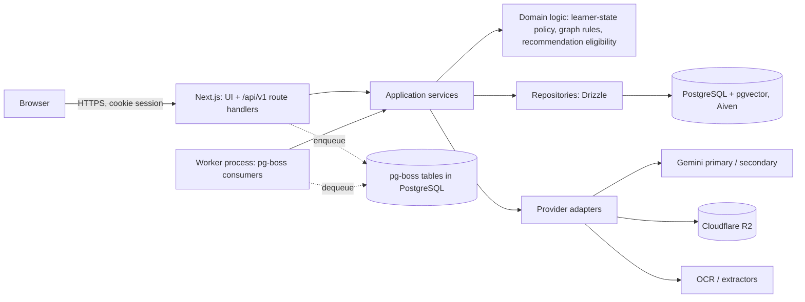

# RecallMap: System Architecture

**Status: approved decisions plus proposed design. Nothing in this document is implemented yet.**
Implemented today: the frontend prototype only (see `docs/FEATURES.md`). Last updated 2026-11-04.

Legend used across the docs: **Approved** (owner decision), **Proposed** (my design, awaiting approval), **Deferred**, **Implemented**.

## 1. Approved architecture (Master Directive A-G)

| Concern | Decision | Status |
|---|---|---|
| Frontend | Existing Next.js App Router, React 19, TypeScript, Tailwind 4, existing UI components, Vitest. Preserved, improved incrementally | Approved |
| API | Next.js route handlers as a **thin transport layer** | Approved |
| Background work | **Separate worker process** (document extraction, OCR, chunking, embeddings, concept extraction, graph generation) | Approved |
| Extraction | API must be extractable into a standalone service later as a deployment/transport change, not a rewrite | Approved |
| Database | PostgreSQL (Aiven) + Drizzle ORM + pgvector; no Supabase | Approved |
| Object storage | Cloudflare R2, private bucket | Approved |
| Queue | PostgreSQL-backed **pg-boss**; no Redis unless a demonstrated technical reason appears | Approved (preferred, subject to verification) |
| Validation | Zod for requests, params, env, AI output, job payloads, provider responses | Approved |
| Auth | Google OAuth only; opaque server sessions, hashed in DB | Approved |
| AI | Gemini behind adapters; primary key first, conditional secondary fallback (see `AI_AND_DOCUMENT_PIPELINE.md`) | Approved |

## 2. Topology



The API and the worker are two entry points over **the same** services and domain code. The worker never re-implements learning logic.

## 3. Code boundaries (Proposed)

The existing repository stays a single package. No monorepo tooling is introduced now.

```
app/                      Next.js UI (existing) + app/api/v1/**/route.ts (thin)
components/, lib/, hooks/ existing frontend code (restructure only where required)
src/contracts/            Zod schemas + inferred types shared by UI and server. No server imports.
src/server/
  platform/               config (Zod env), db client, logger, errors, request context
  modules/<name>/         one folder per module: service.ts, repo.ts, domain/, schemas use contracts
  providers/              gemini/, r2/, ocr/, extractors/  (adapters behind interfaces)
  jobs/                   job names, payload schemas, handlers (call services)
worker/index.ts           worker entry (starts pg-boss, registers handlers)
```

Dependency rules (to be enforced with ESLint `no-restricted-imports` and a CI check):

1. `src/contracts` imports nothing from the server or the UI.
2. `src/server/**` never imports from `app/`, `components/`, `hooks/`, or React.
3. Route handlers contain only: authenticate, parse with Zod, call one service function, map result/errors. No SQL, no business rules.
4. Services take an explicit `userId` from the authenticated context. Repositories **require** `userId` for every user-owned table; there is no unscoped query for user data.
5. Modules talk through service functions, never through another module's repository. No circular imports (CI check).
6. Providers are used only through interfaces defined in the consuming module (`AiProvider`, `ObjectStore`, `TextExtractor`), so tests use fakes.
7. `lib/recallmap/*` pure functions (progress, history, state helpers) remain usable by both UI and server; critical rules move into `src/server/modules/*/domain` as they become authoritative (the learner-state policy, B6).

### Modules (all inside one deployable)

| Module | Responsibility | Depends on |
|---|---|---|
| auth | Google OAuth flow, sessions, CSRF, logout | users |
| users | profile, app preferences, learning preferences, deletion requests | - |
| curriculum | shared templates, versions, nodes (read-mostly) | - |
| subjects | learner subject instances, archive/delete | curriculum, users |
| library | materials metadata, upload authorization, status | subjects, documents |
| documents | storage keys, extraction, OCR, sections, chunks, embeddings | providers |
| knowledge | concepts, prerequisites, provenance, revisions, sources, layout data | subjects, documents |
| assessment | question versions, assessment definitions, attempts, answers, grading | knowledge |
| evidence | evidence records, learner states, transitions (policy engine) | assessment, knowledge |
| progress | read models: progress, trends, history | evidence, assessment |
| recommendations | eligibility rules, AI ranking/explanation, history | evidence, knowledge |
| tutor | conversations, context builder, grounded retrieval | knowledge, documents, ai |
| ai | provider selection, fallback, usage tracking, prompt registry | providers |
| jobs | pg-boss wiring, retry/idempotency helpers | - |

## 4. Request lifecycle

`route.ts` -> session lookup (hash cookie token, check expiry/revocation) -> CSRF/Origin check on unsafe methods -> Zod parse (body, query, params) -> `service.fn(ctx{userId, requestId}, input)` -> repositories (user-scoped) -> typed result -> error mapper to `{ error: { code, message, requestId } }`. No stack traces or internal details leave the server.

## 5. Frontend data access (Proposed, Decision DR-12)

- One typed API client built on `src/contracts`.
- A single `DataSource` interface (`getSubjects`, `getMap`, `getProgress`, ...) with two implementations: `apiDataSource` (authenticated) and `demoDataSource` (explicit demo mode).
- Mode is explicit (a visible `/demo` entry or a labelled provider state), never inferred. **API failure renders an error state, never demo data.** Loading, error, empty, and ready are distinct UI states.
- Dashboard, map, concept details, gaps, progress, history, study sessions, tutor context and recommendations all read through this one interface. This replaces the two parallel paths found in the audit (`LearnerData`/`isDemo` versus direct `DEMO_*` reads in `knowledge.ts`).
- Server cache (for example TanStack Query or SWR) is allowed for responsiveness; it is a cache, never a source of truth. Library choice is DR-12.

## 6. Knowledge-map layouts (Proposed)

- Layout is a pure view concern: `layout(graph, mode) -> positions`. It never writes relationships.
- Hierarchical: layered layout following prerequisite direction (candidate library: ELK via `elkjs`, or `dagre`). Cycles are broken for layout only (feedback-arc handling), the stored graph is unchanged, and cycle edges are flagged in the UI. Disconnected components are laid out side by side.
- Dynamic: force-directed with pan/zoom/drag (candidate: `d3-force` with the existing SVG, or Cytoscape.js / React Flow). Evaluate in B4 on correctness, accessibility (keyboard focus), bundle size, and touch behaviour; prefer an established library to a custom engine.
- Switching preserves selection, filters, learner evidence overlay, and viewport context. Preference stored in `app_preferences.map_layout`.
- The existing `KnowledgeGraph.tsx` has hardcoded positions per demo concept id; that is replaced by the layout function.

## 7. Worker and queue (pg-boss), Proposed operating model

**Why pg-boss.** Jobs live in the same PostgreSQL, so there is no Redis to run. It provides retries with backoff, expiry, singleton keys, scheduling (used for the backup and revision-due jobs), and a dead-letter queue.

**Verification required before B1 (Decision DR-03).** pg-boss version and PostgreSQL version compatibility; that the Aiven plan allows creating the `pgboss` schema and enough connections; behaviour behind Aiven connection pooling (pg-boss should use a **direct** connection, not a transaction-mode pooler; verify).

**Process model.** One worker process initially. It is a long-lived Node process (not serverless). It handles SIGTERM by stopping job intake and finishing in-flight jobs within a grace period, and exposes a health endpoint (also reported through `/api/v1/health`).

**Queues** (names illustrative): `document.process` (stage chain), `document.ocr`, `graph.generate`, `question.generate`, `deletion.execute`, `backup.database`, `revision.scan`, plus a dead-letter queue.

**Retry strategy (initial, configurable).** Retries 3, exponential backoff with jitter (for example 30 s, 2 min, 10 min), per-job expiry (a stuck job returns to the queue), no retry on non-transient errors (validation, unsupported file, policy block). Poison jobs go to the dead-letter queue and mark the material `failed` with a stable `error_code`.

**Idempotency.** Each stage is keyed by `(material_id, stage, pipeline_version)` and checks recorded state before doing work; the enqueue uses a singleton key so a double click or duplicate completion callback creates one job. Stages write their outputs in a transaction together with the stage status, so a crash leaves either "not done" or "done", never half-written chunks.

**Concurrency limits (initial, to be measured).** Extraction 2, OCR 1, embedding batches 2, graph generation 1 per worker; a per-user cap of 2 active processing jobs; global Gemini concurrency capped so quotas are not exhausted by one user.

**Failure recovery.** Worker crash: expired jobs are retried. Poison job: dead-letter plus failed status plus user-visible retry. Database outage: jobs are not lost (they live in the database); the worker backs off. Gemini outage: the stage retries with backoff, then fails with `ai_unavailable` (retryable by the user). Orphan detection: a scheduled job lists R2 objects without rows and rows without objects.

**Aiven connections (docs verified 2026-11-05).** Aiven provides built-in PgBouncer (default transaction mode) on a different port from the direct connection, and both can be used at once. Plan: API (and any serverless runtime) uses the pooled connection with `pgbouncer.max_prepared_statements` reviewed for Drizzle; the worker and pg-boss use the **direct** connection (pg-boss behaviour behind transaction pooling is not verified). pg-boss needs Node 22.12+, PostgreSQL 13+, `pgcrypto` and `CREATE` privilege.

**Free-tier update (2026-11-05).** Aiven free allows 20 connections with no pooling (about 17 usable in simulation), so the budget below uses API 5, worker 2, pg-boss 3 and keeps headroom; the worker can run in three modes (`embedded` inside the web process, `standalone`, `off`) selected by `WORKER_MODE`; pg-boss deduplication needs `exclusive`/`short`/`stately` queue policies with `singletonKey`, handlers honour `job.signal`, and at least two consumers avoid head-of-line blocking (all observed in `docs/testing/INFRA_COMPATIBILITY_SPIKE.md`). See `docs/deployment/FREE_TIER_INFRASTRUCTURE.md`.

**Connection budget.** Aiven plans cap connections. Budget example (confirm against the plan): API pool max 5 per instance (serverless functions need a pooler), worker pool max 5, pg-boss 5, migrations/admin 2. Pool sizes are Zod-validated env settings.

**Hosting requirements and costs.** See `docs/deployment/DEPLOYMENT_REQUIREMENTS.md`. Cost drivers: an always-on worker host, Aiven plan, R2 storage (egress to the internet is not charged by R2; verify current pricing), and Gemini tokens (embeddings, extraction, tutoring). No figures are asserted here; they are collected during the B1 feasibility check.

## 8. Extracting the API later (documented procedure, Proposed)

1. Everything under `src/server` and `src/contracts` already has no Next imports (CI-enforced).
2. Create a new package that mounts the same route table with Fastify/Express (or `Hono`) calling the same services.
3. Move `app/api/v1/**` to proxy or delete; point `NEXT_PUBLIC_API_BASE_URL` at the new origin.
4. Cookies: keep the API on a subdomain of the app domain, `SameSite=Lax`, `Domain` set explicitly. Re-run the cross-user and CSRF suites against the new deployment.
5. The worker is unchanged.

## 9. Conflicts with the previous `docs/ARCHITECTURE.md`

`docs/ARCHITECTURE.md` (milestone 5) predates the directive. It says: email/password plus Google (now Google only), "plain `pg` or Drizzle" (now Drizzle), single process (now API plus worker), `lib/storage` local/s3 providers (now R2 behind an `ObjectStore` adapter), `concept_prerequisites` without provenance (now with provenance and review status). It is kept for history with a note at the top; this file is authoritative.

## 10. Implemented in B1a (2026-11-07), verified locally

```
src/contracts/             errors, health, jobs, preferences (Zod; no server or UI imports)
src/server/platform/       config (Zod env, connection budget, DR-18 guard), logger (redaction), errors, request-context
src/server/http/route.ts   thin Web-standard route wrapper, JSON/query parsing (no Next.js dependency)
src/server/db/             Drizzle schema (identity), client (pools, ping), migrate
src/server/modules/        shared (user scoping), users, preferences, auth (tokens, cookie, session repository + service)
src/server/providers/ai    AiProvider interface, task registry, fake provider, circuit breaker, AiGateway
src/server/providers/storage  ObjectStore interface, in-memory fake, safe key builder
src/server/jobs/           queues, payload schemas, runtime (worker, queue client), heartbeat, status service, embedded start-once
src/server/health.ts       health computation
app/api/v1/health/route.ts only API route so far;  instrumentation.ts starts the embedded worker when WORKER_MODE=embedded
worker/index.ts            standalone worker entry (npm run worker)
scripts/                   migrate.ts, verify-infra.ts, check-cycles.mjs
```
Boundaries are enforced by ESLint `no-restricted-imports` (server and contracts may not import React, Next.js or frontend code; modules may not import each other's repositories) and by `npm run check:cycles`; both were negative-tested with deliberate violations (ER-004). Behaviour verified on the real Next.js server: the frontend runs with no environment at all; health reports `degraded` without a database, `ok` with one, `503 down` when it is unreachable or the configuration is invalid, and recovers by itself after a database restart; the embedded worker starts once, shows `running`, and drains on SIGTERM.
