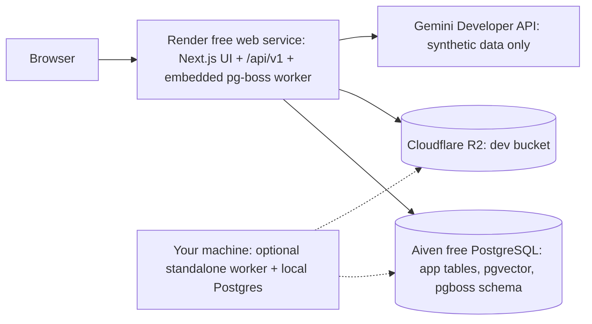

# RecallMap: Free-Tier Infrastructure Assessment, Architecture, Costs and Upgrade Path

**Status: owner-approved starting direction (2026-11-05), verified against official documentation the same day. Nothing is provisioned.** No paid service may be purchased or provisioned without the owner's explicit approval. This is a starting architecture, not a permanent commitment: each service is replaceable independently.

Labels: **Verified** (official source read 2026-11-05), **Third-party** (not official, treat as indicative), **Simulated** (tested on a local stand-in, not on the real service), **Unverified** (not checked).

## 1. Decisions recorded (owner, 2026-11-05)

| Decision | Content |
|---|---|
| DR-03 | Start on **Aiven's free PostgreSQL plan** |
| DR-05 | Start on **Render's free tier** for the Next.js app; worker approach below |
| DR-18 | Keep the Gemini Developer API **for development with synthetic data only**; no real learner data or minors' content until the terms are resolved; AI integration stays provider-independent; the audience stays secondary-school students, independent candidates and other learners (not adults-only); DR-18 stays a **production compliance blocker**; billing, another key, or Vertex AI do **not** automatically resolve it |
| DR-02 | Whether the primary Gemini project has billing enabled is **still unverified** (owner will check) |
| Stack | Next.js on Render + Aiven PostgreSQL free + Drizzle + pgvector (if the plan supports it) + pg-boss + Cloudflare R2 + Gemini (synthetic data) + Google OAuth + TypeScript |

## 2. What each free plan gives (and does not)

### 2.1 Aiven for PostgreSQL, free plan

| Item | Finding | Label |
|---|---|---|
| Price, card | Free indefinitely, no credit card | Verified |
| Resources | Single node, 1 CPU, 1 GB RAM, **1 GB disk** (older third-party pages say 5 GB: outdated, the Nov 2025 Aiven blog says the Developer tier raises storage "from 1 GB to a maximum of 8 GB") | Verified |
| Connections | `max_connections` = **20** | Verified (Aiven free-plan page) |
| Connection pooling | **None** (no PgBouncer on the free plan) | Verified |
| Power-off | Aiven may power off free services with no initial usage in the first hours and with no continuous activity; a notification is sent; you can power it back on; services off for 180+ days may be deleted | Verified (180 days: third-party) |
| Backups | "Backups" are listed as included; **retention, restore options and point-in-time recovery are not documented in what I read**, and backups are subject to the inactivity policy | Verified that backups exist; details **Unverified** |
| Network | Cannot be created in a VPC, **no static IPs**, no integrations, no forking, no support services | Verified |
| High availability / SLA | None (single node, not covered by the 99.99% SLA) | Verified |
| Number of free services | One free PostgreSQL service per account type (older doc) | Third-party, re-check in the console |
| PostgreSQL version | Free plan supports up to 17 per a third-party table; Aiven lists pgvector for 14-17; **PostgreSQL 18 not verified** | Third-party / Unverified |
| pgvector on the free plan | pgvector `vector` 0.8.1 is listed for PostgreSQL 14-17 on Aiven; **whether the free plan allows `CREATE EXTENSION vector` is not stated in what I read** | **Unverified** until the acceptance test (section 7.3) |
| Upgrade path | Developer tier ($5/month per Aiven's blog): up to 8 GB, not auto-powered-off, same 20-connection and no-pooling limits; free services upgrade by adding a payment method, same service (no data move) | Verified (price from the blog post) |

### 2.2 Render, free tier

| Item | Finding | Label |
|---|---|---|
| Free web service | Supported (custom domains, managed TLS, log streams, previews) | Verified |
| Spin-down | A free web service **spins down after 15 minutes without inbound traffic** (HTTP or WebSocket); the next request wakes it, taking about **one minute** | Verified |
| Free hours | **750 free instance hours per workspace per month**; spun-down services do not consume hours; a single always-awake service uses about 744 hours, so a second always-awake free service would exceed it | Verified |
| **Background workers** | **Free instances are not available** for Background Workers, Private Services or Cron Jobs (Render's "Your First Deploy" page) | Verified |
| Resource limits of the free instance | 512 MB RAM and a fraction of a CPU: widely reported, **not confirmed in the pages I read** | Unverified |
| Free Render Postgres | Expires 30 days after creation. **Not used** (we use Aiven) | Verified |
| Build minutes, bandwidth | Counted against monthly included amounts (500 build minutes, 100 GB reported) | Third-party |
| Pre-deploy command, persistent disks | Not available on free web services in my understanding | Unverified |
| Outbound IPs | Shared; Aiven free has no IP allow-list stability (no static IPs on either side) | Unverified for Render |
| Node version | Selectable by environment variable; Node 22.12+ needed by pg-boss; some extraction libraries want 22.13 or 24 | Unverified on Render, library engines Verified (npm) |

### 2.3 Cloudflare R2

| Item | Finding | Label |
|---|---|---|
| Free allowance (Standard storage, monthly) | **10 GB-month storage, 1 million Class A (writes/lists), 10 million Class B (reads), free egress** | Verified (Cloudflare pricing page) |
| Paid rates beyond that | $0.015 per GB-month, $4.50 per million Class A, $0.36 per million Class B, egress free | Verified |
| Presigned URLs | GET/HEAD/PUT/DELETE only, no POST, S3 API domain only, CORS needed | Verified (2026-11-05) |
| Account requirement | Whether R2 activation requires a payment method on file is **not verified**. **Do not add one without deciding it deliberately** | Unverified |

## 3. Compatibility with our architecture

| Requirement | Free-tier result | Notes |
|---|---|---|
| Drizzle ORM + schema + migrations | **Works (Simulated)**: schema with `vector(768)`, `drizzle-kit generate` and `migrate` ran as a **non-superuser** owner role | Spike ER-003 |
| pgvector search | **Works (Simulated)** on pgvector 0.6.0 / PostgreSQL 16: exact cosine top-8 over 5,000 filtered chunks in 29 ms, HNSW 7 ms with the planner using the index. Aiven's 0.8.1 should be a superset | Aiven free plan support itself **Unverified** |
| pgvector extension creation | `vector` is **not a "trusted" extension** on vanilla PostgreSQL, so a non-superuser cannot create it; Aiven documents enabling it with the admin user | Acceptance test required |
| pg-boss | **Works (Simulated)** as a non-superuser owner: schema created, retries with delay, dead-letter, abort of a stuck job through `job.signal` then retry, `exclusive` queue deduplication via `singletonKey`, graceful stop finishing an in-flight job | Spike ER-003; behaviour on Aiven free **Unverified** |
| Connection budget | 20 total; on a stock PostgreSQL 3 are reserved for superusers (we saw failure after 16 client connections beside 4 existing = 20). Aiven reserves some too (**Unverified**), so plan for **about 15-17 usable** | Section 5 |
| Pooling | **Unavailable**: every serverless-style connection counts. Keep one long-lived server process with small pools | Section 5 |
| Vector storage | Measured about **6.3 KB per chunk** (768 dims + about 1.5 KB text + HNSW index). 1 GB disk, minus pg-boss tables, WAL and everything else, means a **development budget of about 50,000 chunks**, far fewer with real documents | Section 6 |
| Backups to R2 | A worker-run `pg_dump` job is impossible while no persistent worker exists; use a manual dump in development | Section 7.6 |
| Availability | Free Aiven may be powered off; free Render sleeps: acceptable for development with synthetic data, **not** for real users | Section 9 |

**Conclusion: nothing found blocks B1 or the non-AI parts of B2-B3.** Blockers and limits that remain: (1) pgvector availability on the Aiven free plan is unverified until you run the acceptance test; (2) a persistent worker is **not** available free on Render (workaround below); (3) 1 GB disk and 20 connections cap development data and concurrency; (4) DR-18 still blocks any real-data AI use.

## 4. Free-tier architecture ("Phase 0")

### 4.1 Worker strategy (decision DR-21, proposed)

A Render **free** service cannot be a dedicated worker, and a free web service sleeps. Do not treat them as equivalent. The cheapest practical approach:

| Mode | How | Use for | Limits |
|---|---|---|---|
| `WORKER_MODE=embedded` (default on Render free) | The pg-boss worker starts inside the Next.js server process (Next.js `instrumentation.ts` hook, server runtime only) | cloud development and demos | Runs **only while the service is awake**. After 15 minutes without inbound requests it sleeps, in-flight jobs get SIGTERM and unfinished work resumes later through pg-boss expiry and retries. Sleeping also skips scheduled jobs. Heavy PDF/OCR in a small free instance risks running out of memory, so dev limits are capped (below) |
| `WORKER_MODE=standalone` | `npm run worker` starts `worker/index.ts` (no web server) | **your machine** (free) for heavy processing, tests, migrations of jobs; later a Render Background Worker (paid) | Needs the machine online. Points at the same Aiven DB and R2 dev bucket |
| `WORKER_MODE=off` | web only | API-only instances, tests | Jobs queue but nothing runs |

Rules that make embedded mode safe:
1. Every handler is **idempotent and resumable** (already required) and honours `job.signal` so an expired or stopping job aborts cleanly (verified in the spike).
2. The processing UI polls a status endpoint, so an active user keeps the service awake while their document processes.
3. Graceful shutdown on SIGTERM: stop fetching, let in-flight work finish within the grace period, then exit (verified: `stop({ graceful: true, wait: true })`).
4. Development caps (configurable): max file 5 MB, 20 pages, one concurrent job, so a 512 MB instance is not exhausted.
5. Scheduled jobs (backup, revision scan) are not relied on in Phase 0.

**Optional keep-warm (not recommended as a default):** an external scheduled ping every under-15 minutes keeps a free service awake but then it consumes about 744 of the 750 free hours, so it must be the only always-awake free service, and you should check Render's terms first. Prefer accepting cold starts in development.

**First paid step if embedded mode proves unreliable:** Render Starter instance for the web service (about $7/month, Third-party), which removes spin-down, so embedded mode becomes reliable; a separate Background Worker (about $7/month, Third-party) comes later (section 9).

### 4.2 Provider independence (DR-18 guard)

All model calls go through an `AiProvider` interface (generate, structured generate, embed) with a Gemini adapter and a fake. Nothing outside `src/server/providers` knows the vendor. A configuration flag `AI_DATA_MODE=synthetic|real` (default `synthetic`) is checked by one gateway function: in `synthetic` mode the gateway refuses prompts built from stored learner data (they must come from fixtures or generated synthetic content); `real` refuses to start unless the deployment has an explicit approval reference (`AI_REAL_DATA_APPROVAL_REF`) recorded in `docs/compliance/THIRD_PARTY_PROCESSORS.md`. This is a technical guard, not a legal resolution.

## 5. Database connection and pooling configuration (Proposed)

With **20** connections and none pooled, assume **17 usable** and budget:

| Consumer | Pool max | Env var |
|---|---|---|
| Web/API (one process) | 5 | `DB_POOL_MAX_API` |
| Embedded or standalone worker application queries | 2 | `DB_POOL_MAX_WORKER` |
| pg-boss (own pool; `max` option) | 3 | `PGBOSS_POOL_MAX` |
| Migrations / admin (run separately, not concurrently with the app) | 1-2 | n/a |
| Local `psql`/Drizzle Studio and console | 2 reserved | n/a |
| **Headroom** | about 4 | |

Rules: one long-lived `pg.Pool` per process; **never create a pool per request**; set `idleTimeoutMillis` and `connectionTimeoutMillis`; the embedded worker shares the web process, so total stays within the budget; do not enable pg-boss LISTEN/NOTIFY on the free plan (it holds an extra dedicated connection; polling is enough). When the budget is exceeded the error is `remaining connection slots are reserved...` (observed in the spike): surface it as `503 database_unavailable`, never as demo data.

**Upgrade-ready database layer:** the code reads `DATABASE_URL` (direct) and optionally `DATABASE_POOLED_URL`; a single `createDb(config)` factory picks them. Domain logic only sees repositories. Moving to a paid Aiven plan changes environment variables (and pool sizes), not code. pg-boss always uses the direct URL.

## 6. Storage budget on 1 GB

Measured (Simulated, PostgreSQL 16): about 6.3 KB per chunk at 768 dimensions with HNSW. Plan for about 50,000 chunks maximum while leaving room for everything else; set pg-boss completed/archived job retention to days, not weeks; keep original files in R2, never in the database; alert at 70% (700 MB) via a size query in the health check. Choose 768 dimensions in development (halves vector storage versus 1536).

## 7. Safe development configuration

1. **Three environments (never share one database for tests and demos):**
   - `local`: Docker/local PostgreSQL (pgvector image; unlimited connections, free), local worker, R2 dev bucket or a local S3-compatible stand-in, synthetic data. This is where automated tests run.
   - `cloud-dev`: Render free web service + one Aiven free service with separate databases (`recallmap_dev`, `recallmap_staging`) and separate roles; R2 buckets with a `-dev` suffix; synthetic data only.
   - `production`: **does not exist yet**; created on paid plans after the triggers in section 9 and the DR-18 resolution.
2. Aiven free allows one free PostgreSQL service per account, so `dev` and `staging` are separate **databases** inside it, sharing the 1 GB and 20 connections.
3. Least privilege: one application role per environment, not the admin role, once the extension is enabled.
4. TLS required (`sslmode=require`); strong generated password; Aiven's IP allow-list is not practical without static IPs: rely on TLS and credentials, and rotate if exposed.
5. Secrets only in Render's environment settings and your local ignored `.env.local`.
6. Synthetic data only (DR-18): fixtures generated for development; no real names, no real student documents, no photos of real notes.
7. Manual `pg_dump` before schema changes; weekly in active development.
8. The health endpoint reports database reachability and disk use; failures show an error page, never demo data (B4 in the architecture).

## 8. What can be implemented now (B1 split)

**B1a, safe now** (no paid service, no unverified infrastructure; tests against a local PostgreSQL): Zod environment configuration (including `APP_ENV`, `WORKER_MODE`, `AI_DATA_MODE`, pool sizes); shared contracts folder; error envelope, request context and redacting logger; boundary lint rules and a circular-dependency check; `createDb` factory and Drizzle setup with the identity tables and first migration, repository pattern with mandatory `userId` and isolation tests; `AiProvider` and `ObjectStore` interfaces with fakes; Gemini and R2 adapters with mocked tests (no live calls); pg-boss wiring with all three worker modes and tests; `/api/v1/health`; a local `docker-compose.yml`; a rewritten `.env.example`; a GitHub Actions workflow (typecheck, lint, tests with a Postgres service container, audit) on the free runner.

**B1b, after you act** (needs resources you create): run the Aiven acceptance test (section 7.3 of the setup guide) and confirm pgvector and the PostgreSQL version; create the Render service and the R2 dev bucket (decide the payment-method question first); give a Gemini key through a secure mechanism for synthetic-data live tests. Until then nothing that depends on pgvector-on-Aiven or live R2 is built (embeddings and document storage land in B3).

**Not before**: any real learner data, and any production deployment, until DR-18 and the compliance items are resolved.

## 9. Cost estimate and upgrade path

All amounts USD per month, indicative. **Only the Aiven Developer $5, the R2 allowances and the R2 rates are from official or vendor pages; Render prices and Gemini usage are third-party or modelled and must be re-checked before you buy anything.** Nothing here is a commitment.

| Phase | Setup | Monthly cost |
|---|---|---|
| 0: now | Aiven free, Render free (web + embedded worker), R2 within free allowance, Gemini free tier with synthetic data, public GitHub repo with free Actions | **$0** |
| 1: reliable beta, still synthetic or approved data | Aiven Developer (not powered off, 8 GB) about $5, Render web Starter about $7 (no spin-down, embedded worker reliable) | **about $12** |
| 2: separate worker | Phase 1 plus a Render Background Worker about $7 | **about $19** plus Gemini usage |
| 3: real learners | Aiven Professional plan with pooling, PITR and HA options (third-party figures range from roughly $12 for a hobbyist single node to about $250 for a 4 GB single node; **quote from aiven.io/pricing before deciding**), larger Render instances, backups and monitoring tools, any compliant AI provider | budget **a separate decision**; not estimated here |

**Gemini usage model (rough, to be measured with `ai_usage` in B5):** a 50-page document is about 40k input tokens. Embedding about $0.15 per million tokens (third-party) is under one cent per document; extraction on a Flash-Lite-class model ($0.25 in / $1.50 out per million, third-party) about 2 cents per document; a tutor turn of about 3k in and 500 out is a fraction of a cent. First-hundred-learner usage is likely single-digit to low double-digit dollars per month on small models, several times more on larger models. Treat as an order of magnitude only. Free-tier Gemini use is $0 but content may be used by Google to improve products, hence synthetic data only.

**Upgrade triggers (any one):**
- Database over **700 MB** (70% of 1 GB), or growth that will reach it within a month: move to Aiven Developer ($5).
- Repeated `too many connections` errors or sustained use above about 14 of 17 usable connections: reduce pool sizes first; if still limited, move to a plan with pooling (Professional).
- Aiven powers the database off during testing more than occasionally, or you need guaranteed availability: Developer tier (not auto-powered-off).
- Cold starts (about a minute) disrupt demos or beta testers, or embedded jobs are repeatedly interrupted by sleep: Render Starter web service.
- Document processing needs more memory/CPU than a free instance provides, or you need scheduled jobs (backups, revision scan) to run reliably: Render Background Worker.
- Any real (non-synthetic) learner data: **not before** DR-18, privacy policy, deletion procedure and verified backups; this implies at least Phase 1 plus a tested restore.
- More than a handful of concurrent testers, or the first public launch: Phase 3 review.

Each upgrade is a configuration change (new `DATABASE_URL`, instance type, `WORKER_MODE`), not a code rewrite, because pooling, worker mode and provider are all behind configuration and interfaces. **The owner approves each purchase before anything is created.**
